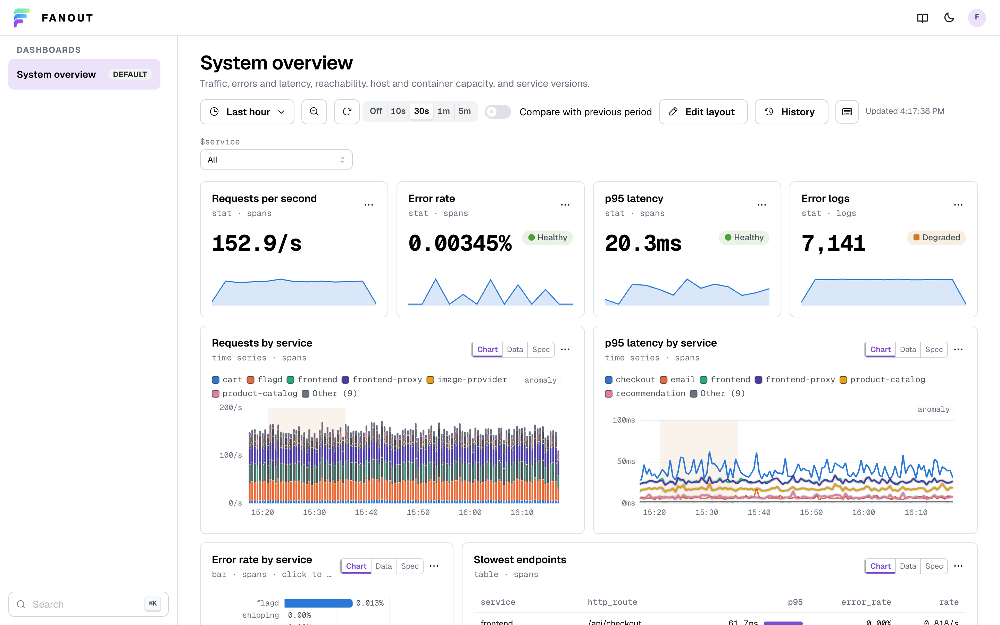

# Fanout

**Observability your agents can operate.** Send OpenTelemetry to one binary, then investigate with
Fanout's built-in agent or connect your own over MCP.

[](https://github.com/labstack/fanout/actions/workflows/ci.yml)
[](LICENSE)
[](https://pkg.go.dev/github.com/labstack/fanout)

<a href="https://fanout.run">
<picture>
  <source media="(prefers-color-scheme: dark)" srcset="site/src/assets/landing/overview-dark.png">
  
</picture>
</a>

Fanout keeps OpenTelemetry traces, logs, and metrics in one binary and one data directory, with no
external storage services to operate. Fanout is pre-release and changes without migration paths; the browser
client, built-in agent, MCP tools, dashboards, and alerts are preview capabilities
([status](https://fanout.run/docs/reference/capabilities)). Start with the
[documentation](https://fanout.run) or run it below.

- OTLP ingest over gRPC and HTTP, with local Parquet storage and DuckDB analytics.
- An investigation agent that answers questions about your telemetry in plain language.
- An MCP server for external agents using the same typed query tools.
- Dashboards across traces, logs, and metrics, and alerts on service error rate, latency,
  throughput, and log volume.

## Quick start

### Docker

```sh
docker run --name fanout -p 7520:7520 \
  -v fanout-data:/var/lib/fanout/data \
  -e FANOUT_AUTH_CODE_SECRET=$(openssl rand -hex 32) \
  labstack/fanout:latest
```

Open the one-time setup URL printed by the container and create the first administrator. Fanout
displays the ingest token exactly once; save it with your collector secrets. For later sign-in
without SMTP, mint a 15-minute, single-use link against the running container's control database:

```sh
docker exec fanout fanout login-link admin@example.com
```

The UI, API, MCP, and both OTLP transports share port `7520`. See
[installation](https://fanout.run/docs/get-started/install) for image defaults and bind-mount ownership, and
[first boot](https://fanout.run/docs/get-started/first-boot) for setup and SMTP login.

### Native binary

Install a checksum-verified release for Linux or macOS, amd64 or arm64:

```sh
curl -fsSL https://raw.githubusercontent.com/labstack/fanout/main/scripts/install.sh | sh
export FANOUT_AUTH_CODE_SECRET=$(openssl rand -hex 32)
fanout
```

Set `FANOUT_VERSION` to a [release tag](https://github.com/labstack/fanout/releases), such as `v2026.10.23-alpha`, to pin a release, and `FANOUT_PREFIX` to choose the installation
directory. Native installs bind `127.0.0.1:7520`; set `FANOUT_ADDR=:7520` for remote access, then
follow the same first-boot setup.

### Send telemetry

A standard OTLP/HTTP exporter can use the saved ingest token:

```sh
export OTEL_EXPORTER_OTLP_PROTOCOL=http/protobuf
export OTEL_EXPORTER_OTLP_ENDPOINT=http://localhost:7520
export OTEL_EXPORTER_OTLP_HEADERS="authorization=Bearer%20$INGEST_TOKEN"
```

For a Collector on the same private container network, the forwarding side is:

```yaml
exporters:
  otlp_http/fanout:
    endpoint: http://fanout:7520
    headers:
      Authorization: "Bearer ${env:INGEST_TOKEN}"

service:
  pipelines:
    traces:  { receivers: [otlp], exporters: [otlp_http/fanout] }
    metrics: { receivers: [otlp], exporters: [otlp_http/fanout] }
    logs:    { receivers: [otlp], exporters: [otlp_http/fanout] }
```

Use an existing `otlp` receiver, set `INGEST_TOKEN`, and replace `fanout` with the Collector's
reachable private hostname. OTLP/gRPC uses `localhost:7520` locally; see [send
telemetry](https://fanout.run/docs/get-started/send-telemetry) for TLS and HTTP/2 setup.

### Enable chat

Select `FANOUT_AI_PROVIDER=anthropic` and inject `ANTHROPIC_API_KEY`, or select
`FANOUT_AI_PROVIDER=openai` and inject `OPENAI_API_KEY`, then restart Fanout; the selected provider
requires its key at startup. With no provider, chat is disabled and the other features still work.
See [AI settings](https://fanout.run/docs/reference/configuration/ai).

### Connect an MCP client

Set `FANOUT_PUBLIC_URL` to your stable, externally reachable HTTPS origin, then point a remote MCP
client at that origin's `/mcp` endpoint. The client discovers and registers through OAuth; you
authorize its scopes in the browser. Fanout serves MCP `2026-07-28` and, through the `initialize`
handshake, `2025-11-25` and `2025-06-18` over Streamable HTTP. See [connect over
MCP](https://fanout.run/docs/guides/mcp) for setup and permissions.

## How it compares

| If you use | Where Fanout differs |
| --- | --- |
| **Grafana with Loki, Tempo, and Mimir** | That stack keeps a service and a query language per signal, plus object storage underneath. Fanout keeps one process, one data directory, and one typed contract across all three signals, at the cost of the horizontal scale those components are built for. |
| **SigNoz** | Both are OTLP-native and self-hosted. SigNoz composes a collector, ClickHouse, and query services; Fanout compiles ingest, authoritative Parquet storage, indexed trace reads, DuckDB analytics, alerting, and the browser client into one binary. |
| **Jaeger** | Jaeger covers traces and expects a storage backend you run separately. Fanout ingests traces, logs, and metrics into the same store, with nothing else to deploy. |
| **Prometheus with Grafana** | Prometheus pulls metrics and is excellent at them. Fanout accepts pushed OTLP for all three signals and is built around investigating a specific incident rather than maintaining long-range metric series. |
| **Datadog**, **Honeycomb**, **Grafana Cloud** | Those are managed services: someone else runs the storage, the scaling, and the upgrades, and your telemetry leaves your network to get there. Fanout is a binary you run, on data that stays on your disk. |
| **An OpenTelemetry Collector piped into ClickHouse** | The same shape, assembled by hand: collector, database, dashboards, and the glue between them. Fanout is that assembly as one program, with an agent and an MCP server already wired to the same query contract. |

Fanout is a single node. It has no clustering, no replication, and no object tier; a deployment that
outgrows one machine's disk and CPU has outgrown Fanout.

## Architecture

One process contains ingest, storage, query, alerts, the agent, MCP, and the React client. Browser
and agent clients share a typed observability contract.


Parquet holds telemetry, DuckDB query state is rebuildable, and SQLite holds transactional product
state. See [how storage works](https://fanout.run/docs/concepts/storage) for durable ingest,
indexed reads, and compaction while reads continue.


## Configuration

Configuration is environment-only: built-in defaults followed by nonempty process environment
values, validated before data files or listeners open. Settings are read once at startup; every
change requires a restart.

| Environment variable | Default | Purpose |
| --- | --- | --- |
| `FANOUT_ADDR` | `127.0.0.1:7520` | UI, API, MCP, and both OTLP transports |
| `FANOUT_DATA_DIR` | `./data` | Parquet, query state, and control SQLite |
| `FANOUT_AUTH_MODE` | `local` | Login link or SMTP, or `oidc` |
| `FANOUT_AUTH_CODE_SECRET` | — | Required in local mode, 32+ characters |
| `FANOUT_AI_PROVIDER` | — | Empty disables chat; `anthropic` or `openai` enables it |
| `ANTHROPIC_API_KEY` | — | Required for Anthropic chat |
| `OPENAI_API_KEY` | — | Required for OpenAI chat |
| `FANOUT_RETENTION_DAYS` | `30` | Telemetry retention window |
| `FANOUT_MCP_ENABLED` | `true` | Serve the MCP endpoint at `/mcp` |

Every secret accepts `<NAME>_FILE` instead of its value; see the [settings
reference](https://fanout.run/docs/reference/configuration) for validation and [runtime secret
delivery](docs/operations.md#runtime-secret-delivery) for deployment examples.

### Advanced DuckDB sizing

Fanout sizes DuckDB automatically; measured workloads can override memory, connections, and threads
as described in [DuckDB sizing](https://fanout.run/docs/reference/configuration#duckdb-sizing).

For TLS, health checks, backups, upgrades, retention, and recovery, see the [operator
runbook](docs/operations.md).

## Performance

Fanout v2026.10.8-alpha accepted **415,859 mixed OpenTelemetry items/s**
over 303.5 seconds on a Hetzner Cloud ccx33 (8 dedicated vCPUs, 32 GB RAM), with
telemetrygen on a separate ccx33. The ingest run on 16 October 2026 passed every
quality gate. See the [performance methodology](https://fanout.run/docs/concepts/performance).
[Fanout Bench](https://github.com/labstack/fanout-bench) reproduces the measurement on your hardware.

## Build from source

- **Go 1.27.3 and a C/C++ toolchain** on native Linux or macOS, amd64 or arm64.
  Build with `just build` or `bash scripts/with-duckdb.sh go build ./cmd/fanout`;
  the wrapper supplies DuckDB's pinned headers, static libraries, and CGO flags.
  The first build needs network access to download the checksum-verified engine.
- **[Bun](https://bun.sh)** — compiles the browser assets
- **Node.js 24.19.0** — runs development helpers and builds the documentation site
- **[just](https://just.systems)** — task runner
- A 32-character **authentication code secret**

```sh
git clone https://github.com/labstack/fanout.git
cd fanout
just install   # browser dependencies and git hooks
just build     # browser assets, then the binary
```

Run it with the minimum configuration:

```sh
export FANOUT_AUTH_CODE_SECRET=$(openssl rand -hex 32) # must be 32+ characters

./bin/fanout
```

Open <http://localhost:7520> and follow first-boot setup. SMTP and chat are optional; without SMTP,
run `./bin/fanout login-link admin@example.com` with the same configuration and data directory.

## Development

Run `just` to list recipes, `just check` for the full gate, `just test` for Go tests, and `just ui`
to rebuild embedded browser assets. See [CONTRIBUTING.md](CONTRIBUTING.md) for environment setup,
generated assets, hooks, and project layout.

## Releases

Versions are CalVer — `vYYYY.M.N[-alpha|-beta|-rc]`, numbered from 0 within each month across all
maturity suffixes. Fanout is alpha (for example, `v2026.10.23-alpha`); GA has no suffix.
Container tags omit the leading `v`, and every release moves `latest`. Tagged releases publish
identical manifests to Docker Hub (`labstack/fanout`) and GHCR (`ghcr.io/labstack/fanout`); GHCR is
canonical and also carries development images.

| Image tag | Points at |
| --- | --- |
| `labstack/fanout:latest` | the newest release, mirrored on Docker Hub |
| `labstack/fanout:2026.10.23-alpha` | that exact release, mirrored on Docker Hub |
| `ghcr.io/labstack/fanout:latest` | the newest release |
| `ghcr.io/labstack/fanout:2026.10.23-alpha` | that exact release |
| `ghcr.io/labstack/fanout:main` | the tip of `main` |
| `ghcr.io/labstack/fanout:sha-<commit>` | one specific commit |

See [docs/release.md](docs/release.md) for platforms, checksums, provenance, and verification.

## Contributing

Issues and pull requests are welcome; follow [CONTRIBUTING.md](CONTRIBUTING.md) and run `just check`
and `just test-race` before opening a pull request. Report security issues through
[SECURITY.md](SECURITY.md).

## Scope

This repository builds Fanout without another repository; LabStack's deployment configuration,
uptime monitoring, and public demo instance are not included. The documentation site in
[`site/`](site) is included, with settings pages generated from the same `internal/config` type the
loader binds and checked by `just check`.

## License

[Apache-2.0](LICENSE) © LabStack LLC. See [NOTICE](NOTICE) and
[THIRD_PARTY_NOTICES](THIRD_PARTY_NOTICES) for attribution, and
[TRADEMARK](TRADEMARK.md) for use of the Fanout name and logo.
